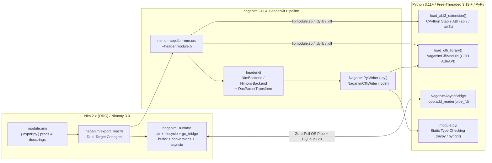

# naganim — Bidirectional Nim ↔ Python Bridge

[](#status)
[](LICENSE)
[](https://www.python.org)
[](https://nim-lang.org)

> [!WARNING]
> **Experimental / Pre-Alpha Software — Not Ready for Production**
> This project is an active research and development prototype. APIs, ABI layouts, and wire formats are unstable and subject to breaking changes without notice. Do not use in production systems.

`naganim` is a high-performance, bidirectional bridge between **Nim** (Nim 2.x ORC/ARC & Nimony 3.0) and **Python** (CPython 3.11–3.15, Free-Threaded PEP 703 `3.13t`–`3.15t`, and PyPy via CFFI), built on [`lockfree`](https://github.com/elijahr/lockfree) and [`headerkit`](https://github.com/axiomantic/headerkit).

---

## Why `naganim`?

Traditional Python/Nim bindings either rely on `#include <Python.h>` macros that break across CPython minor releases and Free-Threaded (`abi3t` / PEP 703) builds, copy byte buffers across the FFI boundary, or risk deadlocking and crashing when Nim's ORC cycle collector runs destructors on non-Python threads without the GIL.

`naganim` solves all five problems in one cohesive stack:

1. **Direct CPython Limited API (`abi3` & Free-Threaded `abi3t` / PEP 703 & PEP 803)** — Binds directly to CPython's stable C-ABI symbols without `<Python.h>` preprocessor macro lock-in, declaring `Py_mod_gil = Py_MOD_GIL_NOT_USED` and supporting 32-byte `PyObject_FT` headers on free-threaded Python.
2. **Dual-Target `{.exportpy.}` Compilation** — A single `{.exportpy.}` pragma emits both a CPython `PyCFunction` slot (`naganim_py_<name>`) and a pure C-ABI entrypoint (`naganim_c_<name>`) with embedded `.naganim.ir.json` type metadata for CFFI and PyPy.
3. **Zero-Copy PEP 3118 Buffers** — `PinnedBuffer[T]` and `ScopedSeqBuffer[T]` expose native Nim memory directly to Python `memoryview`, `numpy.frombuffer`, and CFFI `ffi.buffer` with atomic export reference counting that prevents use-after-free and resize hazards.
4. **Wait-Free Deferred `Py_DecRef` GC Bridge** — When Nim ORC destructors (`=destroy`) run on arbitrary native worker threads without a Python thread state, `PyObj` enqueues the `PyObject*` into a wait-free `BQueue128` + `TreiberStack` retirement queue and drains it safely on the next Python boundary call or event-loop turn.
5. **First-Class `headerkit` `NimBackend` & `NimonyBackend` Integration** — Generates PEP 484 `.pyi` type stubs and CFFI `.cdef` declarations directly from Nim declarations and doc comments via `headerkit`'s `NimBackend`, `NimonyBackend`, and `DocParserTransform`.

---

## Architecture Overview



---

## Key Capabilities

### 1. `{.exportpy.}` Macro & Automatic C-ABI Wrapper Emission (`src/naganim/export_macro.nim`)
Annotate any Nim proc with `{.exportpy.}` (or `{.pyexport.}`) and call `naganimInitModule("module_name")`:
- Generates `naganim_py_<name>` (`PyCFunction`) with automatic `fromPyRaw` argument unpacking, `toPyRaw` return marshaling, and `pyAbiBoundary` exception translation into Python exceptions.
- Generates `naganim_c_<name>` (`exportc, cdecl, dynlib`) guarded by `cAbiBoundary` with thread-local error reporting (`naganim_last_error()`) and a 16-slot thread-local string return ring.
- Embeds compile-time signature and docstring metadata (`naganim_module_ir_json()`) directly inside the compiled shared library.

### 2. Zero-Copy PEP 3118 Buffer Protocol (`src/naganim/buffer.nim`)
- **Tier 1 (`PinnedBuffer[T]`)**: Allocated on the shared heap (`allocShared0`) with unified atomic `refCount` and `exportCount`. Immune to Nim `seq[T]` reallocation; freed only when both Nim owners and all Python `memoryview` / CFFI consumers release their views.
- **Tier 2 (`ScopedSeqBuffer[T]`)**: Wraps a Nim `seq[T]` with an atomic `exportCount` guard. Mutating or resizing (`mutateAdd`, `mutateSetLen`) while a Python `memoryview` is exported raises `BufferExportedDefect` (mapped to Python `BufferError`).

### 3. Lock-Free Deferred `Py_DecRef` GC Bridge (`src/naganim/gc_bridge.nim`)
- `PyObj` wraps `PyObjectPtr` with Nim 2.0 ARC/ORC `=destroy`, `=copy`, and `=sink` hooks.
- If `=destroy` executes on a thread where `PyGILState_Check() == 0` (such as a `TaskPool` worker thread), the pointer is pushed into a wait-free `BQueue128[pointer, 4096]` (backed by a lock-free `TreiberStack[pointer]` overflow) without acquiring the GIL.
- Cross-thread reader borrow guards (`enterBorrow()` / `exitBorrow()`) suspend deferred reclamation while lock-free containers hold transient borrowed references.

### 4. Wait-Free `asyncio` Completion Bridge (`src/naganim/asyncio.nim`, `python/naganim/asyncio.py`)
- `NaganimAsyncBridge` offloads CPU-bound Nim tasks onto a native work-stealing `TaskPool` while releasing the GIL.
- Worker threads publish completions to a wait-free `BQueue128` ring and perform a 0-to-1 edge-triggered write to a non-blocking OS pipe registered with `loop.add_reader(read_fd, ...)`.
- `AsyncChannel` provides native `async for item in channel:` streaming from Nim threads to Python coroutines with zero polling timers.

### 5. Automatic `.pyi` Stub & CFFI Loader Generation via `headerkit` (`python/naganim/writer_plugin.py`, `python/naganim/_cli.py`)
- `NaganimWriterPlugin` combines embedded `.naganim.ir.json` metadata with `headerkit`'s `NimBackend` (`prepare_c_parse_args`, `clean_nim_c_unit`) and `DocParserTransform` (`SourceMeta` and `ParsedDoc`).
- Emits complete PEP 484 `.pyi` type stubs (preserving docstrings, parameter types, `Option[T] -> T | None`, `Table[K, V] -> dict[K, V]`, `PinnedBuffer[T] -> memoryview`) and `.cdef` files via `naganim build`.

---

## Quickstart

### 1. Write a Nim Extension Module (`math_ext.nim`)

```nim
import std/[options, tables]
import naganim

proc add_ints*(a: int64, b: int64): int64 {.exportpy.} =
  ## Add two 64-bit integers and return their sum.
  result = a + b

proc scale_series*(values: seq[float64], factor: float64): seq[float64] {.exportpy.} =
  ## Multiply every element in `values` by `factor`.
  result = newSeq[float64](values.len)
  for i, v in values:
    result[i] = v * factor

proc make_iota_buffer*(n: int64): PinnedBuffer[uint8] {.exportpy.} =
  ## Allocate a zero-copy PEP 3118 PinnedBuffer[uint8] of length `n`.
  var buf = newPinnedBuffer[uint8](int(n), readonly = false)
  let data = buf.dataOpenArray()
  for i in 0 ..< int(n):
    data[i] = uint8(i and 0xFF)
  return buf

naganimInitModule("math_ext")
```

### 2. Build the Shared Library, `.pyi` Stubs, and `.cdef` via `naganim build`

```bash
naganim build math_ext.nim --out-dir ./build --nim-path ./src
```

This compiles `libmath_ext.dylib` (or `.so` / `.dll`), runs `headerkit`'s `NimBackend` and `DocParserTransform`, and generates `build/math_ext.pyi` and `build/math_ext.cdef`:

```python
# Auto-generated by headerkit (NaganimPyiWriter)
from __future__ import annotations

def add_ints(a: int, b: int) -> int:
    """Add two 64-bit integers and return their sum."""
    ...

def scale_series(values: list[float], factor: float) -> list[float]:
    """Multiply every element in `values` by `factor`."""
    ...

def make_iota_buffer(n: int) -> memoryview: ...
```

### 3. Call from Python (CPython `abi3`/`abi3t` or CFFI)

```python
from naganim import load_abi3_extension, load_cffi_library

# Option A: Load directly as a CPython Stable ABI (abi3 / abi3t) extension module
ext = load_abi3_extension("math_ext", "build/libmath_ext.dylib")
assert ext.add_ints(20, 22) == 42
assert ext.scale_series([1.5, 2.5, 3.0], 2.0) == [3.0, 5.0, 6.0]

with ext.make_iota_buffer(16) as mv:
    assert isinstance(mv, memoryview)
    assert list(mv[:4]) == [0, 1, 2, 3]

# Option B: Load via CFFI ABI mode (works on CPython, Free-Threaded Python, and PyPy)
cffi_mod = load_cffi_library("build/libmath_ext.dylib")
assert cffi_mod.add_ints(100, 200) == 300
with cffi_mod.make_iota_buffer(8) as buf_owner:
    assert bytes(buf_owner.to_buffer()) == bytes(range(8))
```

---

## Documentation

- [**Overview & Quickstart (`docs/index.md`)**](docs/index.md)
- [**Architecture Deep Dive (`docs/architecture.md`)**](docs/architecture.md)
- [**Complete Nim & Python API Reference (`docs/api-reference.md`)**](docs/api-reference.md)

---

## Development & Testing

```bash
# Run the Python test suite (CPython abi3/abi3t, CFFI, PEP 3118 buffers, asyncio, HeaderKit stubs)
uv run pytest

# Run the full Nim + Python test suite via Nimble
nimble test

# Lint Python sources with Ruff
uv run ruff check .

# Run strict static type checking with Mypy
uv run mypy python
```

---

## License

MIT License — see [LICENSE](LICENSE) for details.
