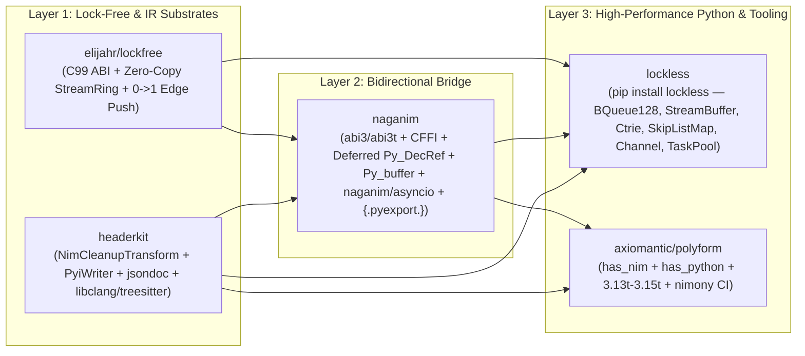

# Stage 2: System Architecture & Technical Design Specification (`design.md`)

**Author**: `@pyon-architect` (Spring-Compass — Staff Systems Architect)
**Task ID**: `msg_1793182245_pyon-orchestrator_4119` (Phase 0, Task 0.1)
**Date**: 2026-10-28
**Status**: Ready for Stage 3 Adversarial Design Audit (`@pyon-auditor`)

---

## 1. Architectural Vision & Ecosystem Topology

The Pyon ecosystem delivers a zero-compromise, production-grade bridge between Nim (2.x & Nimony 3.0) and Python (CPython 3.12–3.15, Free-Threaded 3.13t–3.15t, and PyPy via CFFI), anchored on five tightly integrated components:



### Core Architectural Invariants
1. **Zero-Exception C-ABI Firewall**: No Nim `Exception` or `Defect` may ever unwind across a C or Python FFI boundary. Every exported symbol is wrapped in an explicit boundary template that either sets a Python exception (`PyErr_SetString`) and returns `NULL`/`-1` (in `abi3` mode) or returns a typed status code (`lf_status_t` in CFFI/C-ABI mode).
2. **Thread-State-Agnostic `PyObj` Destruction**: Destroying a `PyObj` on any non-Python OS thread (such as a `lockfree` `TaskPool` worker or `lf_item_destructor_fn` callback) is wait-free and never calls `Py_DECREF` without an attached `PyThreadState`.
3. **Zero-Syscall Steady-State Async Wakeups**: Producer threads pushing into `naganim/asyncio` or `lockless.Channel` perform an OS wakeup (`eventfd` / `kqueue` / loopback pipe) **if and only if** the queue transitions from `0 -> 1` (`was_empty == true`) **and** the consumer event loop is marked `sleeping == true` under a `moSequentiallyConsistent` Dekker fence.
4. **Two-Point Diff & Zero Shelfware**: Every module across `lockfree`, `headerkit`, `naganim`, and `lockless` has both a provider implementation and a live consumer call-site verified by end-to-end tests.

---

## 2. Component 4 Specification: `elijahr/lockfree` C-ABI Upgrades

**Repository**: `/Users/eek/Development/lockfree`
**Modified Files**:
- `/Users/eek/Development/lockfree/include/lockfree.h`
- `/Users/eek/Development/lockfree/include/lockfree_bqueue128.h`
- `/Users/eek/Development/lockfree/include/lockfree_streambuffer.h`
- `/Users/eek/Development/lockfree/src/lockfree/bqueue128.nim`
- `/Users/eek/Development/lockfree/src/lockfree/streambuffer.nim`
- `/Users/eek/Development/lockfree/src/lockfree/cabi.nim`
- `/Users/eek/Development/lockfree/tests/test_cabi.nim`

### 2.1 Two-Phase Zero-Copy `StreamBuffer` / `StreamRing` C ABI
Currently, `/Users/eek/Development/lockfree/include/lockfree_streambuffer.h:89-107` and `/Users/eek/Development/lockfree/src/lockfree/cabi.nim:2613-2686` expose `lf_stream_ring_acquire_write_iov` returning `lf_iovec_pair_t` by value. To support zero-copy `memoryview` / `Py_buffer` reservations without struct-by-value FFI marshaling overhead, we add pointer/length out-parameter functions to `include/lockfree_streambuffer.h` and `src/lockfree/cabi.nim`:

```c
/* include/lockfree_streambuffer.h */

/**
 * Reserves writable byte slices of up to `requested_bytes` (or all available
 * writable space when `requested_bytes == 0`) without copying.
 *
 * - On `LF_OK`: `*out_ptr1` and `*out_len1` hold the primary contiguous writable
 *   slice (`>= 1` byte). If the reservation wraps around the physical ring end
 *   on a non-mirrored buffer, `*out_ptr2` and `*out_len2` hold the second slice
 *   (otherwise `*out_ptr2 = NULL`, `*out_len2 = 0`; on virtual-mirrored rings,
 *   wrap-around is contiguous in virtual memory so `*out_ptr2` is always `NULL`).
 * - On `LF_ERR_FULL`: 0 writable bytes are currently available (`*out_ptr1 = NULL`,
 *   `*out_len1 = 0`).
 * - On `LF_ERR_INVALID_ARG`: `sb == NULL`, `out_ptr1 == NULL`, or `out_len1 == NULL`.
 */
lf_status_t lf_stream_reserve_write(
    lf_streambuffer_t* sb,
    size_t requested_bytes,
    uint8_t** out_ptr1,
    size_t* out_len1,
    uint8_t** out_ptr2,
    size_t* out_len2
);

/**
 * Commits `committed_bytes` bytes previously reserved via `lf_stream_reserve_write`
 * using `moRelease` memory ordering on the producer write index.
 *
 * - Returns `LF_OK` on success, `LF_ERR_INVALID_ARG` if `sb == NULL` or
 *   `committed_bytes > lf_stream_ring_available_write(sb)`.
 */
lf_status_t lf_stream_commit_write(
    lf_streambuffer_t* sb,
    size_t committed_bytes
);

/**
 * Peeks at the available readable byte slices in the ring buffer without
 * advancing the consumer read index.
 *
 * - On `LF_OK`: `*out_ptr1` points to the first unread byte and `*out_len1`
 *   holds the primary contiguous readable byte count (`>= 1`). If unread data
 *   wraps around the physical ring end on a non-mirrored buffer, `*out_ptr2`
 *   and `*out_len2` hold the second slice (`NULL` / `0` otherwise).
 * - On `LF_ERR_EMPTY`: no unread bytes are available (`*out_ptr1 = NULL`,
 *   `*out_len1 = 0`).
 * - On `LF_ERR_INVALID_ARG`: `sb == NULL`, `out_ptr1 == NULL`, or `out_len1 == NULL`.
 */
lf_status_t lf_stream_peek_read(
    const lf_streambuffer_t* sb,
    const uint8_t** out_ptr1,
    size_t* out_len1,
    const uint8_t** out_ptr2,
    size_t* out_len2
);

/**
 * Advances the consumer read index by `consumed_bytes` bytes using `moRelease`
 * memory ordering after zero-copy consumption of slices from `lf_stream_peek_read`.
 *
 * - Returns `LF_OK` on success, `LF_ERR_INVALID_ARG` if `sb == NULL` or
 *   `consumed_bytes > lf_stream_ring_available_read(sb)`.
 */
lf_status_t lf_stream_consume_read(
    lf_streambuffer_t* sb,
    size_t consumed_bytes
);
```

**Implementation Mechanics in `src/lockfree/streambuffer.nim` & `src/lockfree/cabi.nim`**:
- Because `initStreamRing` (`streambuffer.nim:295-296`) currently raises `ValueError` when `useVirtualMirror == true`, `StreamRing` instances are constructed with `use_virtual_mirror = false`, and `acquireWriteIov(ring.raw[], cap)` returns the contiguous slice up to the physical wrap boundary (`iov.first` with `min(avail, cap - tailIdx)` bytes).
- If `min_bytes > 0` and `iov.first.len < min_bytes`, `lf_stream_reserve_write` returns `LF_ERR_FULL`.
- Both `lf_stream_*` and `lf_streambuffer_*` / `lfq_stream_*` aliases are exported for full C ABI symmetry with `/Users/eek/Development/lockfree/include/lockfree_streambuffer.h:113-138`.

### 2.2 0-to-1 Empty-to-Non-Empty Transition Flag (`out_was_empty`)
To eliminate redundant kernel wakeups in event-loop bridges (`naganim/asyncio` and `lockless.Channel`), we add `tryPushEx` to `src/lockfree/bqueue128.nim` (`lines 114-150`) and expose `lf_bqueue128_push_ex` and `lf_push_ex` in `include/lockfree_bqueue128.h`, `include/lockfree.h`, and `src/lockfree/cabi.nim`:

```c
/* include/lockfree.h (Section 1: Queue) */
lf_status_t lf_push_ex(
    lf_producer_t* prod,
    void* item,
    bool* out_was_empty
);
lf_status_t lf_queue_push_ex(
    lf_producer_t* prod,
    void* item,
    bool* out_was_empty
);

/* include/lockfree_bqueue128.h */
lf_status_t lf_bqueue128_push_ex(
    lf_bqueue128_t* queue,
    void* item,
    bool* out_was_empty
);
```

**Exact Transition Invariant**:
1. **`BQueue128.tryPushEx(self: var BQueue128[T, N], val: T, wasEmpty: var bool): bool`** (`src/lockfree/bqueue128.nim`):
   - When `self.tail.compareExchangeWeak(pos, pos + 1, moRelaxed, moRelaxed)` succeeds at `bqueue128.nim:132` and the slot publish `while not compareExchangeWeak(cell[], expected, desired): discard` completes at `bqueue128.nim:138-139`:
   - `wasEmpty = (self.head.load(moAcquire) == pos)`. Because `pos` is the exact sequence ticket claimed by this push and `head` advances monotonically from `0`, `head == pos` holds if and only if all prior items `[0, pos)` had been popped (or `pos == 0` on an initial empty queue) when this item was published.
2. **`boundedPushEx[N, P, C]`** (`src/lockfree/cabi.nim:177-185`):
   - Immediately after `p.bound.push(item)` succeeds, inspects `let h = q.rawQueue.head.load(moAcquire)` and `let t = q.rawQueue.tail.load(moAcquire)`, setting `out_was_empty[] = (t - h <= 1'u64)`.
3. **`unboundedPushEx[S, MaxThreads]`** (`src/lockfree/cabi.nim:364-370`):
   - In `Queue[T, ccMulti, ccMulti, ...]` (`src/lockfree/queue.nim:392, 404`), `itemCount: Atomic[int]` is incremented on push. `was_empty` is `true` iff `q.rawQueue.itemCount.load(moAcquire) <= 1` immediately after `p.bound.push(item)`.

### 2.3 Deterministic Destructor Drain Guarantee on `unboundedQueueDestroy`
In `/Users/eek/Development/lockfree/src/lockfree/cabi.nim:600-630`, `unboundedQueueDestroy` currently attempts `registerThread(q.rawQueue[].manager[])` to construct a `Bound` consumer and pop remaining items. If all `MaxThreads` slots in `DebraManager` were previously occupied, `registerThread` raises `DebraRegistrationError` (`line 607`) and skips the destructor loop!
- **Upgrade**: In `unboundedQueueDestroy`, if `registerThread` fails (or after the `b.pop()` loop completes), walk `var seg = q.rawQueue[].headSegment.load(moAcquire)` through `seg.next.load(moAcquire)` and invoke `q.base.destructor(cast[pointer](cellPair.second), q.base.userData)` on any remaining filled (`not seqIsClosed(cellPair.first) and cellPair.first != 0`) LCRQ cells, clearing them before `=destroy(q.rawQueue[])`. This guarantees zero leaked `PyObject*` references on queue teardown under all thread-registration states.

---

## 3. Component 3 Specification: `headerkit` Upgrades

**Repository**: `/Users/eek/Development/headerkit`
**Modified / Created Files**:
- `/Users/eek/Development/headerkit/headerkit/_cli.py`
- `/Users/eek/Development/headerkit/headerkit/backends/libclang.py`
- `/Users/eek/Development/headerkit/headerkit/backends/treesitter.py`
- `/Users/eek/Development/headerkit/headerkit/transforms/nim_cleanup.py` *(new)*
- `/Users/eek/Development/headerkit/headerkit/transforms/nim_jsondoc.py` *(new)*
- `/Users/eek/Development/headerkit/headerkit/transforms/__init__.py`
- `/Users/eek/Development/headerkit/headerkit/writers/pyi.py` *(new)*
- `/Users/eek/Development/headerkit/headerkit/writers/__init__.py`

### 3.1 CLI `-b` / `--backend` Short Flag (`headerkit/_cli.py:181-187`)
Update `_build_parser()` in `/Users/eek/Development/headerkit/headerkit/_cli.py:181-187`:
```python
parser.add_argument(
    "-b",
    "--backend",
    dest="backend",
    metavar="NAME",
    default=None,
    help="Backend name (default: libclang)",
)
```

### 3.2 `nimbase.h` Auto-Resolution in `LibclangBackend` (`headerkit/backends/libclang.py`)
In `/Users/eek/Development/headerkit/headerkit/backends/libclang.py`:
- Add a cached helper `_get_nim_libpath() -> str | None` that locates Nim's standard library directory containing `nimbase.h` by:
  1. Checking `shutil.which("nim")`, running `nim dump` with `stderr=subprocess.STDOUT, timeout=5`, and parsing the line after `lib` or matching `nimbase.h` in candidate directories (`<nim_bin_dir>/../lib`, `~/.choosenim/toolchains/*/lib`).
  2. Verifying `Path(libpath, "nimbase.h").is_file()`.
- In `LibclangBackend.parse()` (`libclang.py:4654-4665`), if `"nimbase.h"` is referenced in `code` and no directory in `include_dirs` already contains `nimbase.h`, automatically append `f"-I{nim_libpath}"` to `args`.

### 3.3 `nimbase.h` Macro Normalization in `TreeSitterBackend` (`headerkit/backends/treesitter.py`)
In `/Users/eek/Development/headerkit/headerkit/backends/treesitter.py`:
- Add `_normalize_nimbase_macros(code: str) -> str` invoked in `TreeSitterBackend.parse()` (`treesitter.py:485`) when `nimbase.h` or `N_NIMCALL`/`N_CDECL`/`N_LIB_EXPORT`/`N_LIB_PRIVATE` appears in `code`:
  - Strip storage/visibility markers: `\b(?:N_LIB_PRIVATE|N_LIB_EXPORT|N_LIB_IMPORT|N_NIM_DEPRECATED)\b` $\to$ `""`.
  - Rewrite calling-convention function declarators:
    - `\b(?:N_NIMCALL|N_CDECL|N_STDCALL|N_INLINE|N_NOCONV|N_FASTCALL|N_SAFECALL)\s*\(\s*([^,]+?)\s*,\s*([A-Za-z_][A-Za-z0-9_]*)\s*\)` $\to$ `\1 \2`
    - `\b(?:N_NIMCALL_PTR|N_CDECL_PTR|N_STDCALL_PTR|N_NOCONV_PTR)\s*\(\s*([^,]+?)\s*,\s*([A-Za-z_][A-Za-z0-9_]*)\s*\)` $\to$ `\1 (*\2)`
  - Preserves line breaks (`\n`) so `SourceLocation.line` (`ir.py:72`) remains 100% accurate.

### 3.4 `NimCleanupTransform` (`headerkit/transforms/nim_cleanup.py`)
A new `PipelineFilter` subclass `NimCleanupTransform(PipelineFilter)` exported from `headerkit.transforms`:
1. **Internal Symbol Filtering**:
   - Removes declarations whose names match Nim compiler/runtime internals:
     - Exact names: `{"NimMain", "NimMainInner", "NimMainModule", "PreMain", "PreMainInner", "cmdCount", "cmdLine", "gEnv", "signalHandler", "nimFrame", "popFrame"}`
     - Prefixes: `nim_`, `Nim_`, `eqdestroy_`, `eqcopy_`, `eqsink_`, `eqwasMoved_`, ` eqdup_`, `atmdotdotats`
2. **Parameter & Identifier Hygiene Cleanup**:
   - Strips Nim 2.0 parameter disambiguation suffixes `_p0`, `_p1`, ..., `_p\d+` from `Parameter.name` (`re.sub(r"_p\d+$", "", param.name)`).
   - Strips Nim gensym suffixes `` `gensym\d+ `` and `_gensym\d+` from parameter and field identifiers.
3. **Nim Base C Type Normalization**:
   - Uses a dedicated `_rewrite_nim_type(type_expr: TypeExpr) -> TypeExpr` visitor (rather than `rewrite_type_references`, which only maps `str -> str` on `CType.name`) so `CType("NCSTRING", quals)` is widened directly to `Pointer(CType("char", list(quals)))` and scalar Nim typedefs are mapped to standard C99 `CType`s:
     - `NI` $\to$ `CType("intptr_t")`
     - `NU` $\to$ `CType("uintptr_t")`
     - `NI8`, `NI16`, `NI32`, `NI64` $\to$ `CType("int8_t")`, `CType("int16_t")`, `CType("int32_t")`, `CType("int64_t")`
     - `NU8`, `NU16`, `NU32`, `NU64` $\to$ `CType("uint8_t")`, `CType("uint16_t")`, `CType("uint32_t")`, `CType("uint64_t")`
     - `NF`, `NF64` $\to$ `CType("double")`; `NF32` $\to$ `CType("float")`
     - `NIM_BOOL` $\to$ `CType("bool")`
     - `NIM_CHAR` $\to$ `CType("char")`
     - `NCSTRING` $\to$ `Pointer(CType("char"))`

### 3.5 `NimJsonDocEnricher` (`headerkit/transforms/nim_jsondoc.py`)
A `PipelineFilter` subclass `NimJsonDocEnricher(PipelineFilter)` that enriches a `SourceUnit` parsed from a Nim-generated C header with docstrings, original parameter names, and high-level type metadata extracted from `nim jsondoc` (or `.naganim.ir.json`):
- Adds `doc: str | None = None` to `@dataclass(slots=True)` declarations (`Function`, `Struct`, `Enum`, `Typedef`) in `headerkit/ir.py` (remediating `[CRIT-02]`).
- Accepts `jsondoc_path: Path | str | None = None` or `nim_source_path: Path | str | None = None` (or pre-parsed `entries: list[dict]`).
- Matches JSON doc entries (`{"name": ..., "type": "skProc" | "skType" | ..., "description": ..., "code": ...}`) against `Function.name`, `Struct.name`, `Enum.name`, and `Typedef.name`.
- Populates `Function.doc` with cleaned plain-text/Markdown docstrings and restores any parameter names that were erased or mangled in C emission.

### 3.6 PEP 484 `.pyi` Stub Writer (`headerkit/writers/pyi.py`)
A new `PyiWriter` registered as `"pyi"` (`-w pyi`) in `headerkit/writers/pyi.py`:
- **Type Mapping (`TypeExpr` $\to$ Python PEP 484 type annotation)**:
  - `void` $\to$ `None`
  - `bool`, `_Bool`, `NIM_BOOL` $\to$ `bool`
  - Fixed/standard integer types (`int`, `int8_t`..`int64_t`, `uint8_t`..`uint64_t`, `size_t`, `ssize_t`, `intptr_t`, `uintptr_t`, `ptrdiff_t`, `long`, `short`) $\to$ `int`
  - `float`, `double` $\to$ `float`
  - `Pointer(CType("char"))` (`char*`, `const char*`) $\to$ `bytes | str` (in parameters) / `bytes` (in return types)
  - `Pointer(CType("void"))` (`void*`) $\to$ `int | Any` (or `ctypes.c_void_p` / opaque handle class when matched)
  - `Pointer(CType(struct_name))` where `struct_name` is an opaque struct (`Struct(fields=[])` or `Typedef` to opaque struct) $\to$ `struct_name` class reference
  - `FunctionPointer` $\to$ `Callable[[ParamTypes...], ReturnType]`
  - `Enum` $\to$ `class <EnumName>(enum.IntEnum): ...` with typed integer members
  - `Struct` $\to$ `class <StructName>: ...` with typed field attributes (or opaque handle class if `fields == []`)
  - `Function` $\to$ `def <name>(<typed_params>) -> <return_type>: ...` (or with docstring triple-quoted body when `func.doc` is populated).
- **Consumer Wiring**: Registered in `headerkit/writers/__init__.py:_ensure_writers_loaded()` (`line 375`) and mapped in `headerkit/_cli.py:_EXTENSION_TO_WRITER` (`line 416`, `".pyi": "pyi"`).

---

## 4. Component 1 Specification: `naganim` (Bidirectional Nim $\leftrightarrow$ Python Bridge)

**Repository**: `/Users/eek/Development/naganim` (Standalone Git Repository, Dual-Packaged as `naganim.nimble` + `pyproject.toml`)

### 4.1 Directory & Module Structure
```text
/Users/eek/Development/naganim/
├── naganim.nimble
├── pyproject.toml
├── README.md
├── CHANGELOG.md
├── src/
│   ├── naganim.nim                  # Umbrella Nim export
│   └── naganim/
│       ├── abi3.nim               # Python 3.11+ Stable ABI (0x030B0000) + PEP 703/803 abi3t declarations
│       ├── nimony_compat.nim      # Nim 2.x & Nimony 3.0 conditional compilation & pragma compatibility
│       ├── pyobj.nim              # PyObj ARC/ORC wrapper + borrowed/owned ref semantics
│       ├── gc_bridge.nim          # Wait-Free Deferred Py_DecRef Queue (backed by lockfree BQueue128)
│       ├── marshal.nim            # Zero-copy & value marshaling (primitives, string, seq, Table, Option, tuples)
│       ├── buffer.nim             # Two-Tier PEP 3118 Py_buffer provider & consumer (PinnedBuffer + seq/StreamRing)
│       ├── asyncio.nim            # Lock-free MPSC completion ring + 0->1 edge-triggered wakeup coalescer
│       ├── macros.nim             # {.pyexport.} & {.pyimport.} compile-time typed macros + .naganim.ir.json emitter
│       └── cffi_abi.nim           # Dual-mode C-ABI export shim for CFFI/PyPy fallback
├── python/
│   └── naganim/
│       ├── __init__.py            # Python runtime loader (abi3/abi3t extension + CFFI fallback), build helpers
│       ├── _cli.py                # `naganim build` / `naganim stubgen` CLI integrating headerkit
│       ├── _cffi_loader.py        # CFFI API/ABI dynamic loader consuming .naganim.ir.json / headerkit
│       └── py.typed               # PEP 561 marker
└── tests/
    ├── nim/
    │   ├── test_abi3_marshal.nim
    │   ├── test_gc_bridge.nim
    │   ├── test_buffer.nim
    │   └── test_asyncio.nim
    └── python/
        ├── test_naganim_extension.py
        ├── test_buffer_zero_copy.py
        ├── test_asyncio_bridge.py
        └── test_freethreaded_gc.py
```

### 4.2 Unified C-ABI Core + Dual Target Support (`naganim/abi3.nim` & `naganim/cffi_abi.nim`)
`naganim` compiles every `{.pyexport.}` function into two layers from a single Nim source definition:
1. **Canonical C-ABI Core Function (`cdecl`, `gcsafe`, `raises: []`)**:
   - Accepts and returns C ABI types or `PyObjectPtr` handles with an explicit `cAbiBoundary` firewall.
2. **Target A — CPython Stable ABI (`abi3` / `abi3t`) Wrapper**:
   - Declares CPython Stable ABI functions directly in Nim via `{.importc, cdecl.}` (without `#include <Python.h>`, avoiding CPython 3.13t/3.14t's `#error "Py_LIMITED_API is incompatible with Py_GIL_DISABLED"`, remediating `[MED-01]`) and exclusively calls the exported function symbols `Py_IncRef(PyObjectPtr)` and `Py_DecRef(PyObjectPtr)` rather than inline struct-offset refcount macros.
   - Uses **Multi-Phase Module Initialization (PEP 489)** via `PyModuleDef_Init` and `PyModuleDef_Slot`:
     - `Py_mod_exec` (`1`): Executes module initialization and attaches exported functions, constants, and `PyType_FromSpec` heap types.
     - `Py_mod_multiple_interpreters` (`3`): Set to `Py_MOD_PER_INTERPRETER_GIL_SUPPORTED` (`2`).
     - `Py_mod_gil` (`4`): Set to `Py_MOD_GIL_NOT_USED` (`(void*)1`) when compiled for CPython 3.13+ (`Py_3_13t` / `3.14t` / `3.15t`), preventing CPython from re-enabling the GIL upon `import`!
3. **Target B — CFFI API/ABI Mode (`naganim/cffi_abi.nim` + `python/naganim/_cffi_loader.py`)**:
   - Exports the C-ABI core symbols in a shared library (`lib<mod>.so` / `.dylib` / `.dll`) alongside the generated C header and `.naganim.ir.json`.
   - `naganim._cffi_loader` uses `headerkit` (`CffiWriter` + `NimCleanupTransform`) to bind the shared library via CFFI for PyPy or pure-C-ABI consumers.

### 4.3 `PyObj` & Wait-Free Deferred `Py_DecRef` Queue (`naganim/pyobj.nim` & `naganim/gc_bridge.nim`)
```nim
type
  PyObjectPtr* = distinct pointer

  PyObj* = object
    raw*: PyObjectPtr
```
- **Reference Counting & Thread-Safety Contract**:
  - When `PyObj` is copied (`=copy`) or sunk (`=sink`) on a thread holding a valid Python thread state (`PyGILState_Check() == 1`), `Py_IncRef` / `Py_DecRef` is invoked directly.
  - **Destruction from Non-Python Threads (`=destroy(self: var PyObj)`)**:
    1. If `self.raw == nil`: no-op.
    2. Check `PyGILState_Check() != 0` (which returns `1` on any thread with an attached `PyThreadState` in both GIL-enabled 3.12+ and Free-Threaded 3.13t+ builds):
       - If `1`: call `drainDeferredDecRefs()` (draining up to `64` queued `PyObjectPtr`s via `Py_DecRef`) and then `Py_DecRef(self.raw)`.
       - If `0` (called from a pure Nim `TaskPool` worker thread, OS background thread, or `lockfree` destructor callback without an attached `PyThreadState`):
         - Push `cast[pointer](self.raw)` into the global wait-free `gDeferredDecRefQueue` (`lf_bqueue128_t*` of capacity `65536`, backed by `elijahr/lockfree`'s `BQueue128`, with an overflow TreiberStack `lf_stack_t*` fallback so it can never drop a reference even if >65,536 objects are destroyed between Python boundary crossings).
    3. Every `naganim` Python entry/exit wrapper and `naganim/asyncio` wakeup callback invokes `drainDeferredDecRefs()` on the active Python thread, guaranteeing bounded, leak-free reclamation without ever calling `PyGILState_Ensure()` inside a Nim destructor (which would deadlock against locks held by Python threads).

### 4.4 Two-Tier Zero-Copy Buffer Protocol (`naganim/buffer.nim`)
Implements PEP 3118 (`Py_buffer`) under the Stable ABI (`Py_LIMITED_API >= 0x030B0000`, where `Py_buffer` and `PyBuffer_FillInfo` are part of the Limited API):

1. **Tier 1: `PinnedBuffer[T]` & `StreamRing` Views (True Cross-Thread Zero-Copy)**:
   - Backed by cache-aligned shared memory (`allocShared0` / `posix_memalign`) or `lockfree` `StreamRing` (`VirtualMirrorBuffer`).
   - Header contains `exportCount: Atomic[int]` and `rc: Atomic[int]`.
   - `bf_getbuffer` (`Py_bf_getbuffer` slot `1` in `PyType_Slot`) increments `exportCount` (`moAcquireRelease`) and fills `Py_buffer` (`buf`, `len`, `itemsize = sizeof(T)`, `format`, `ndim = 1`, `shape`, `strides`, `readonly`).
   - `bf_releasebuffer` (`Py_bf_releasebuffer` slot `2` in `PyType_Slot`) decrements `exportCount` (`moAcquireRelease`). If the owner dropped the buffer while Python held a `memoryview`, the underlying memory is freed only when both `rc == 0` and `exportCount == 0`.
2. **Tier 2: Nim `seq[T]` / `string` Scoped Buffer Views**:
   - Exposes a Nim `seq[T]` or `string` to Python as a zero-copy `memoryview` with a pin counter `activeExports: Atomic[int]`.
   - Any attempt to mutate length or unpin while `activeExports.load(moAcquire) > 0` raises `BufferExportedDefect` (translated at the FFI boundary to `BufferError`), preventing Use-After-Free on `seq` reallocation.

### 4.5 `naganim/asyncio` — Zero-Syscall Edge-Triggered Async Bridge (`naganim/asyncio.nim`)
Bridges Nim background threads (`lockfree` `TaskPool`, Chronos, or native threads) with Python's `asyncio.AbstractEventLoop`:

```mermaid
sequenceDiagram
    participant NimWorker as Nim Worker Thread (TaskPool)
    participant Ring as Lock-Free Completion Ring (BQueue128)
    participantFd as Wakeup FD (eventfd / pipe)
    participant PyLoop as Python asyncio Event Loop (add_reader)

    Note over PyLoop,Ring: Steady State (Consumer Polling)
    NimWorker->>Ring: lf_bqueue128_push_ex(ring, completionPtr, &was_empty)
    Note over NimWorker: was_empty == false OR loop.sleeping == false -> 0 syscalls!
    PyLoop->>Ring: Drain batch (up to 256 completions) & resolve asyncio.Future

    Note over PyLoop,Ring: Idle Transition (Queue Empty)
    PyLoop->>Ring: sleeping.store(true, moSeqCst)
    PyLoop->>Ring: Re-check lf_bqueue128_is_empty(ring) (Dekker fence)
    NimWorker->>Ring: lf_bqueue128_push_ex(ring, completionPtr, &was_empty)
    Note over NimWorker: was_empty == true AND sleeping.exchange(false, moSeqCst) == true
    NimWorker->>participantFd: write(wakeup_fd, 1) (Single 0->1 Edge Syscall)
    participantFd->>PyLoop: Epoll/Kqueue readable -> drain_completions()
```

- **Completion Ring**: `lf_bqueue128_t` (capacity `16384`) holding `ptr AsyncCompletionCell` (`futurePyObj: PyObjectPtr`, `status: CompletionStatus`, `resultConverter: proc(ctx: pointer): PyObjectPtr`, `ctx: pointer`, `errMsg: cstring`).
- **Wakeup Coalescer**:
  - Uses a non-blocking OS pipe (`os.pipe()` / socketpair on Windows, `eventfd` on Linux when available) registered once with `loop.add_reader(read_fd, _on_wakeup)`.
  - Atomic state `consumerSleeping: Atomic[bool]` shared between Nim and the extension module.
  - Producer after `lf_bqueue128_push_ex(ring, cell, addr wasEmpty)`:
    ```nim
    threadFence(moSequentiallyConsistent)
    if consumerSleeping.load(moSequentiallyConsistent):
      if consumerSleeping.exchange(false, moSequentiallyConsistent):
        notifyWakeupFd(writeFd)
    ```
  - Consumer in `_on_wakeup()`:
    1. Drains `read_fd`.
    2. Loops popping batches of up to `256` `AsyncCompletionCell` items from `ring`, resolving `future.set_result(...)` or `future.set_exception(...)`.
    3. Sets `consumerSleeping.store(true, moSequentiallyConsistent)`.
    4. Executes Dekker double-check: if `not lf_bqueue128_is_empty(ring)` and `consumerSleeping.exchange(false, moSequentiallyConsistent)`, loops again immediately (or schedules `loop.call_soon(_on_wakeup)` if a producer is transiently preempted between `tail` CAS and cell DWCAS, remediating `[HIGH-02]`) to prevent lost wakeups!

### 4.6 `{.pyexport.}` Compile-Time Typed Macro & `.naganim.ir.json` (`naganim/macros.nim`)
- `{.pyexport.}` inspects the typed Nim procedure AST (`nnkProcDef`), extracting:
  - Procedure name, Nim parameter names & types, return type, default values, and doc comments (`nnkCommentStmt`).
  - Emits:
    1. The `abi3` `METH_FASTCALL` wrapper `naganim_wrap_<name>` with automatic `marshal.fromPy` / `marshal.toPy` conversion and `cAbiBoundary` exception translation.
    2. The C-ABI `exportc` wrapper `naganim_cabi_<name>` for CFFI/headerkit consumption.
    3. Appends the procedure descriptor to a compile-time metadata table written out as `<module>.naganim.ir.json` alongside the binary, consumed by `headerkit` (`NimJsonDocEnricher` + `PyiWriter`) to generate 100% accurate `.pyi` stubs and CFFI bindings.

---

## 5. Component 2 Specification: `lockless` (Standalone Python Package)

**Repository**: `/Users/eek/Development/lockless` (`pip install lockless` / `import lockless`)
**Dependencies**: Built on `elijahr/lockfree` + `naganim` + `headerkit`.

### 5.1 Package Architecture & Public API
```text
/Users/eek/Development/lockless/
├── pyproject.toml
├── lockless.nimble
├── README.md
├── CHANGELOG.md
├── nim/
│   └── lockless_ext.nim           # Native abi3/abi3t + C-ABI extension powered by naganim & lockfree
├── src/
│   └── lockless/
│       ├── __init__.py            # Public exports
│       ├── __init__.pyi           # Generated via headerkit -w pyi
│       ├── _core.py               # Extension loader + Pythonic wrapper classes
│       └── py.typed
└── tests/
    ├── test_queues.py             # BQueue128, SpscQueue, MpmcQueue + free-threaded concurrency tests
    ├── test_streambuffer.py       # Zero-copy memoryview reserve_write / peek_read + numpy/memoryview tests
    ├── test_maps_and_broadcast.py # ConcurrentDict (Ctrie), SkipListMap, BroadcastRing
    └── test_async_and_taskpool.py # Channel async for + TaskPool.map / submit
```

### 5.2 Python Class Specifications & Lifetimes
All `lockless` containers storing Python objects increment `Py_INCREF` when an object enters the container (`push`, `put`, `publish`) and transfer ownership (`steal` reference) on `pop`/`take`, or `Py_INCREF` on non-destructive reads (`get`, `peek`, `poll`), with a registered `lf_item_destructor_fn` / `lf_entry_destructor_fn` that routes unpopped `PyObject*` pointers through `naganim`'s wait-free deferred `Py_DecRef` queue upon container destruction or overwrite!

1. **`BQueue128[T](capacity: int = 1024)`**:
   - Wraps `lf_bqueue128_t` (`include/lockfree_bqueue128.h`).
   - Methods: `push(item: T) -> bool`, `push_ex(item: T) -> tuple[bool, bool]` (`(ok, was_empty)`), `pop() -> T` (raises `lockless.Empty` when empty) / `try_pop(default=None) -> T | None`, `peek() -> T`, `clear() -> None`, `__len__() -> int`, `capacity: int`, `is_empty: bool`, `is_full: bool`.
2. **`SpscQueue[T](capacity: int = 1024)` & `MpmcQueue[T](capacity: int = 0, max_threads: int = 64)`**:
   - `SpscQueue` wraps `BQueue[pointer, ccSingle, ccSingle, N, 0, 0]` for wait-free single-producer single-consumer transport.
   - `MpmcQueue` wraps `lf_bounded_mpmc_create` (when `capacity > 0`) or `lf_unbounded_mpmc_create` (when `capacity == 0`), automatically managing per-thread `lf_producer_t` / `lf_consumer_t` handles via thread-local storage (`pthread_key_create` / Nim `{.threadvar.}` destructor) so Python `threading.Thread` callers never have to manually acquire/release producer handles!
   - Methods: `push(item: T) -> bool`, `pop() -> T`, `try_pop(default=None) -> T | None`, `pop_batch(max_count: int = 64) -> list[T]`, `close() -> None`, `is_closed: bool`, `__len__() -> int`, `is_empty: bool`.
3. **`StreamBuffer(capacity: int = 65536, virtual_mirror: bool = False)`**:
   - Wraps `lf_stream_ring_t` (`include/lockfree_streambuffer.h`) with the new two-phase zero-copy C ABI (`lf_stream_reserve_write`, `lf_stream_commit_write`, `lf_stream_peek_read`, `lf_stream_consume_read`).
   - Methods:
     - `reserve_write(min_bytes: int = 1) -> memoryview`: Returns a writable zero-copy `memoryview` directly over the `StreamRing` contiguous writable slice.
     - `commit_write(nbytes: int) -> None`: Advances the producer tail with `moRelease`.
     - `peek_read() -> memoryview`: Returns a read-only zero-copy `memoryview` over all contiguous unread bytes.
     - `consume_read(nbytes: int) -> None`: Advances the consumer head with `moRelease`.
     - `write(data: Buffer) -> int` / `readinto(buf: WritableBuffer) -> int` / `read(max_bytes: int = -1) -> bytes`.
     - Context-manager helpers `write_view(min_bytes: int)` and `read_view()` for RAII reserve/commit.
4. **`BroadcastRing[T](capacity: int = 1024, overflow: Literal["drop_oldest", "backoff"] = "drop_oldest", max_readers: int = 64)`**:
   - Wraps `BroadcastRing[PyRefBox]` (`src/lockfree/broadcast.nim`) where each published Python object is wrapped in an atomic reference-counted box tracked in a companion slot table so multiple subscribers can read concurrently and `omDropOldest` / `destroy` safely decrefs overwritten or remaining items via `naganim`'s deferred decref queue (remediating `[HIGH-03]`).
   - Methods: `publish(item: T) -> None`, `subscribe(from_earliest: bool = False) -> BroadcastSubscriber[T]`, `subscriber_count: int`, `capacity: int`, `__len__() -> int`.
   - `BroadcastSubscriber[T]`: `poll() -> tuple[Literal["ok", "empty", "lagged"], T | None, int]`, `try_read(default=None) -> T | None`, `lag: int`, `close() -> None`, `__enter__` / `__exit__`.
5. **`ConcurrentDict[K, V]()` (alias `Ctrie[K, V]`)**:
   - Wraps `Ctrie` (`src/lockfree/ctrie.nim`) with Python key hash/equality support and `O(1)` wait-free `snapshot()`. In `lockless_ext.nim`, `put(k, v): Option[V]` and `remove(k): Option[V]` inspect the returned displaced value and route any replaced/removed `PyObject*` directly to `naganim`'s deferred `Py_DecRef` queue (remediating `[HIGH-03]`).
   - Methods: `__setitem__(k, v)`, `__getitem__(k) -> V`, `__delitem__(k)`, `__contains__(k) -> bool`, `get(k, default=None)`, `put(k, v) -> bool`, `pop(k, default=...) -> V`, `compute_if_absent(k, fn: Callable[[K], V]) -> V`, `snapshot() -> ConcurrentDictSnapshot[K, V]`, `keys()`, `values()`, `items()`, `__len__() -> int`.
6. **`SkipListMap[K, V]()`**:
   - Wraps `SkipListMap` (`src/lockfree/skiplist.nim`) maintaining keys in sorted order, routing displaced/deleted `PyObject*` entries to `naganim`'s deferred `Py_DecRef` queue on overwrite/delete (`[HIGH-03]`).
   - Methods: `__setitem__(k, v)`, `__getitem__(k) -> V`, `__delitem__(k)`, `__contains__(k) -> bool`, `get(k, default=None)`, `pop(k, default=...) -> V`, `items() -> list[tuple[K, V]]`, `keys() -> list[K]`, `values() -> list[V]`, `__iter__()`, `__len__() -> int`.
7. **`Channel[T](capacity: int = 1024)`**:
   - Combines `BQueue128` (`lf_bqueue128_push_ex`) with `naganim/asyncio`'s 0-to-1 edge-triggered wakeup coalescer.
   - Supports both synchronous cross-thread producer/consumer calls (`send_nowait(item)`, `recv_nowait()`) and `asyncio` coroutines (`await ch.send(item)`, `await ch.recv()`, `async for item in ch:`), closing cleanly when `ch.close()` is called.
8. **`TaskPool(num_workers: int = 0)`**:
   - Wraps `lf_taskpool_t` (`src/lockfree/taskpool.nim`).
   - Methods:
     - `submit(fn: Callable, *args, **kwargs) -> asyncio.Future`: Submits work to the work-stealing pool and resolves the returned `asyncio.Future` via `naganim/asyncio` completion ring.
     - `map(fn: Callable[[T], R], items: Sequence[T], chunk_size: int = 1) -> list[R]`: Parallel map across worker threads (releasing the GIL on GIL builds and running in parallel on Free-Threaded 3.13t+ builds).
     - `parallel_for(start: int, stop: int, fn: Callable[[int], None], chunk_size: int = 1) -> None`: Direct binding to `lf_taskpool_parallel_for`.
     - `sync() -> None`, `shutdown() -> None`, `num_workers: int`, `__enter__` / `__exit__`.

---

## 6. Component 5 Specification: `axiomantic/polyform` Upgrades

**Repository**: `/Users/eek/Development/polyform` (cloned from `axiomantic/polyform`, isolated on a Vine strand / feature branch, never committing directly to `main`).
- **Template Upgrades**:
  - When `has_nim == true` and `has_python == true`, scaffold:
    - `pyproject.toml` with `naganim` and `headerkit` build hooks (`[project.optional-dependencies]`, `[tool.headerkit]`).
    - Nim extension entrypoint using `import naganim` and `{.pyexport.}`.
    - Automated `.pyi` stub generation step via `headerkit -b tree-sitter -w pyi`.
- **CI Matrix Upgrades (`.github/workflows/ci.yml.jinja`)**:
  - CPython matrix: `["3.12", "3.13", "3.13t", "3.14", "3.14t", "3.15", "3.15t"]` via `actions/setup-python` / `deadsnakes` / `uv python install`.
  - Nim compiler matrix: Nim 2.2.x stable + `nimony` compatibility job.

---

## 7. Failure-Mode & Adversarial Stress Analysis (Stage 2.2 Synthesis)

| Failure Scenario | Root Cause Hazard | Architectural Defense |
| :--- | :--- | :--- |
| **F1: Non-Python Thread Destroys `PyObj`** | Worker thread in `TaskPool` or `lf_queue_destroy` drops last reference to a `PyObj` without holding the GIL or a `PyThreadState`. | `PyObj.=destroy` checks `PyGILState_Check()`. When `0`, it enqueues the `PyObjectPtr` into `gDeferredDecRefQueue` (`lf_bqueue128_t` + overflow `lf_stack_t`) instead of calling `Py_DecRef`. Drained automatically on the next Python thread entry/wakeup. |
| **F2: Lost Wakeup in `naganim/asyncio` / `lockless.Channel`** | Consumer sees empty queue, prepares to sleep; producer pushes item and checks `consumerSleeping == false` before consumer sets `consumerSleeping = true`. | Strict Dekker protocol with `moSequentiallyConsistent` fences on both sides: Consumer sets `consumerSleeping.store(true, moSeqCst)` *then* re-checks `lf_bqueue128_is_empty(ring)`; Producer publishes item (`lf_bqueue128_push_ex`), executes `threadFence(moSeqCst)`, and checks `consumerSleeping.exchange(false, moSeqCst)`. Mathematically impossible for both to miss each other. |
| **F3: Dangling `memoryview` on `StreamBuffer` Destroy** | User calls `mv = buf.reserve_write(64)` and destroys/GCs `buf` while `mv` is still alive. | The `memoryview`'s `Py_buffer.obj` holds a strong `Py_INCREF` reference to the owning `StreamBuffer` / `PinnedBuffer` Python object (`PyBuffer_FillInfo` contract), preventing `tp_dealloc` from firing until `mv.release()` is called. Furthermore, `StreamBuffer.close()` raises `BufferError` if `exportCount > 0`. |
| **F4: Unbounded Queue Destroy with Full Debra Thread Table** | `unboundedQueueDestroy` fails `registerThread` when all `MaxThreads` slots are full, skipping `destructor` callbacks. | `unboundedQueueDestroy` falls back to walking `headSegment` $\to$ `next` directly and invoking `q.base.destructor` on every unconsumed LCRQ cell (`src/lockfree/cabi.nim:600-630`). |
| **F5: Free-Threaded Python 3.13t+ Re-Enabling the GIL on Import** | Traditional `PyModule_Create` extensions without `Py_mod_gil` cause CPython 3.13t+ to print a runtime warning and re-enable the GIL globally. | `naganim/abi3.nim` uses multi-phase initialization (`PyModuleDef_Init`) and unconditionally emits `{Py_mod_gil, Py_MOD_GIL_NOT_USED}` in the `PyModuleDef_Slot` array when `Py_GIL_DISABLED` or runtime 3.13+ is active. |

---

## 8. Implementation Phasing & Lock Schedule Alignment

Per `/Users/eek/Development/pyon/implementation_plan.md`:
- **Phase 1 (Parallel)**:
  - Task 1.1 (`@pyon-implementer`, lock `repo:headerkit:writers-init`): `headerkit` upgrades (`-b`, `libclang` `nimbase.h` auto-libpath, `treesitter` macro norm, `NimCleanupTransform`, `NimJsonDocEnricher`, `PyiWriter`).
- **Phase 2 (Parallel with Phase 1)**:
  - Task 2.1 (`@pyon-architect`, lock `repo:lockfree:cabi-headers`): `elijahr/lockfree` C-ABI upgrades (`lf_stream_reserve_write`/`commit_write`/`peek_read`/`consume_read`, `lf_push_ex`, `lf_bqueue128_push_ex`, `unboundedQueueDestroy` fallback drain, unit tests in `tests/test_cabi.nim`).
- **Phase 3 (Depends on Phases 1 & 2)**:
  - Task 3.1 (`@pyon-architect`, lock `repo:naganim:core`): `naganim` core runtime (`abi3`/`abi3t`, `PyObj` + deferred `Py_DecRef` queue, Two-Tier `Py_buffer`, `naganim/asyncio`, `nimony_compat`).
  - Task 3.2 (`@pyon-implementer`, lock `repo:naganim:macros-packaging`): `naganim` `{.pyexport.}` macro, `.naganim.ir.json`, `headerkit` integration, dual packaging, test suite.
- **Phase 4 (Depends on Phase 3)**:
  - Task 4.1 (`@pyon-implementer`, lock `repo:lockless:all`): `lockless` standalone Python package (`BQueue128`, `SpscQueue`, `MpmcQueue`, `StreamBuffer`, `BroadcastRing`, `ConcurrentDict`/`Ctrie`, `SkipListMap`, `Channel`, `TaskPool`).
- **Phase 5 (Depends on Phases 3 & 4)**:
  - Task 5.1 (`@pyon-implementer`, lock `repo:polyform:templates`): `axiomantic/polyform` templates & CI matrix upgrades.
