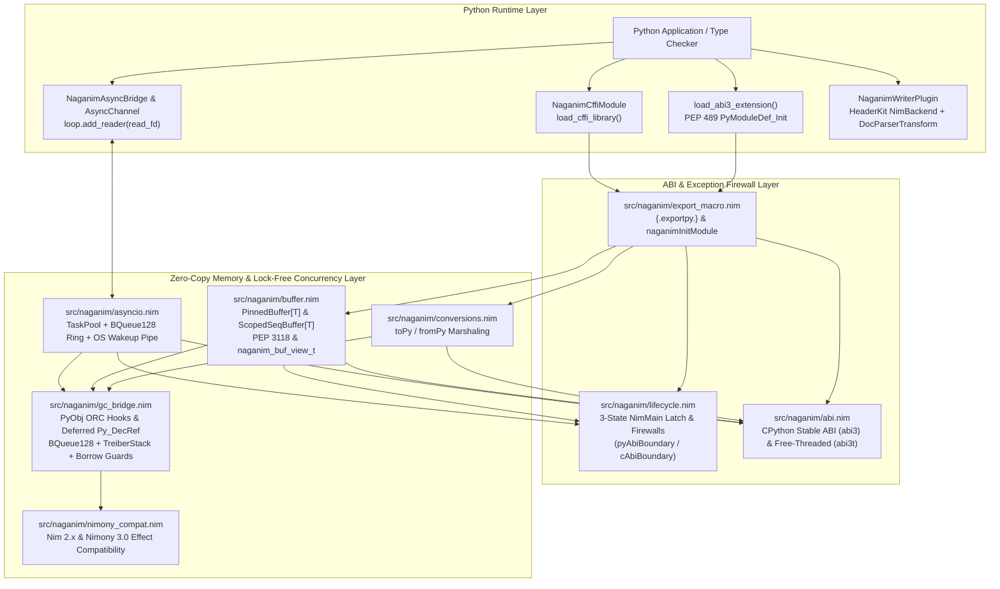

# `naganim` Architecture Deep Dive

> [!WARNING]
> **Experimental / Pre-Alpha Software — Not Ready for Production**
> This project is an active research and development prototype. APIs, ABI layouts, and wire formats are unstable and subject to breaking changes without notice. Do not use in production systems.

`naganim` is architected from first principles to bridge Nim 2.x (ORC/ARC) and Nimony 3.0 with Python 3.11+ (including Free-Threaded PEP 703 `python3.13t` / `python3.14t` and PyPy) without C preprocessor fragility, buffer copies, or cross-thread GIL deadlocks.

---

## System Layer Diagram

---

## 1. Direct CPython Stable ABI (`abi3` & Free-Threaded `abi3t`) — `src/naganim/abi.nim`

Including `<Python.h>` directly in Nim via `{.header: "<Python.h>".}` couples compiled binaries to a single CPython minor version and triggers `#error` directives under `Py_LIMITED_API` on Free-Threaded Python (`Py_GIL_DISABLED`, PEP 703 / PEP 803).

`src/naganim/abi.nim` binds directly to CPython's exported C-ABI functions (`{.importc, cdecl.}`) and defines explicit binary-compatible layouts for both standard and free-threaded runtimes:

- **Standard Limited API (`PyObject` / `PyModuleDef`)**: 16-byte object header (`ob_refcnt`, `ob_type`) on 64-bit platforms.
- **Free-Threaded ABI (`PyObject_FT` / `PyModuleDef_FT`)**: 32-byte object header (`ob_tid`, `ob_flags`, `ob_mutex`, `ob_gc_bits`, `ob_ref_local`, `ob_ref_shared`, `ob_type`).
- **Runtime Free-Threading Detection (`isFreeThreadedRuntime()`)**: Probes the active runtime at initialization and selects the appropriate module definition layout and reference-count inspection formula (`ob_ref_local + (ob_ref_shared shr 2)`).
- **PEP 489 & PEP 703 Module Slots**: Exports `Py_mod_exec` (`1`), `Py_mod_multiple_interpreters` (`3`), and `Py_mod_gil` (`4`, set to `Py_MOD_GIL_NOT_USED = 1` when running on Python 3.13+) so CPython never re-enables the GIL when loading a `naganim` extension.

---

## 2. Runtime Lifecycle & Exception Firewalls — `src/naganim/lifecycle.nim`

### 3-State Atomic `NimMain()` Spin-Latch
When multiple threads load or initialize a Nim shared library concurrently, a naive boolean flag (`if not initialized: initialized = true; NimMain()`) allows a second thread to enter Nim procedures before `NimMain()` finishes initializing global state and thread-local storage.

`naganim_init_runtime()` enforces a 3-state atomic state machine on `gNimInitState`:
1. `NimInitUninit (0)` $\to$ `NimInitRunning (1)` via `compareExchange`. The winning thread executes `NimMain()` and publishes `NimInitReady (2)` with `moRelease`.
2. Any concurrent thread observing `NimInitRunning (1)` spins with `cpuRelax()` until `gNimInitState.load(moAcquire) == NimInitReady (2)`.

### Exception Firewalls (`cAbiBoundary` & `pyAbiBoundary`)
Allowing a Nim exception or `Defect` to unwind across a C or Python stack frame causes immediate undefined behavior. Every exported entrypoint is wrapped in one of two firewalls:
- **`pyAbiBoundary`**: Catches `NaganimConversionError` (maps to `PyExc_TypeError`), `BufferExportedDefect` / `IndexDefect` (maps to `PyExc_BufferError`), `CatchableError` (maps to `PyExc_RuntimeError`), and `Defect` (maps to `PyExc_RuntimeError`), sets the Python exception via `PyErr_SetString`, and returns `nil`.
- **`cAbiBoundary`**: Catches all `CatchableError` and `Defect` instances, records the message in thread-local storage (`gThreadLastError`), and returns a non-zero `cint` status code (`-1`) so CFFI wrappers can inspect `naganim_last_error()` and raise `NaganimRuntimeError`.

---

## 3. Wait-Free Deferred `Py_DecRef` GC Bridge — `src/naganim/gc_bridge.nim`

Nim 2.0's `--mm:orc` memory manager uses deterministic reference counting (`=destroy`, `=copy`, `=sink`). When a `PyObj` wrapper is destroyed:
- **On a thread with an active Python thread state (`PyGILState_Check() == 1`) and zero active cross-thread borrowers**: `naganim` flushes any queued deferred decrements and calls `Py_DecRef(raw)` directly.
- **On a non-Python native worker thread (`PyGILState_Check() == 0`) or while a lock-free container holds a borrow guard (`gActiveBorrowers > 0`)**: Calling `Py_DecRef` directly would corrupt CPython's reference counts or crash, and calling `PyGILState_Ensure()` inside an ORC destructor risks AB-BA deadlocks with the Python GIL. Instead, `enqueueDeferredDecRef(raw)` pushes the `PyObjectPtr` into a wait-free bounded ring (`BQueue128[pointer, 4096]`, backed by an unbounded lock-free `TreiberStack[pointer]` overflow) and triggers registered wakeup hooks (`notifyDeferredWakeupHooks()`).

### Cross-Thread Borrow Guards (`enterBorrow` / `exitBorrow`)
Lock-free associative containers (such as `lockless`'s `ConcurrentDict` and `SkipListMap`) read borrowed `PyObject*` pointers before incrementing their Python refcount on the caller thread. Calling `naganim_enter_borrow()` before reading and `naganim_exit_borrow()` after `Py_IncRef` guarantees that `flushDeferredDecRefs()` and `naganim_pop_deferred_decref_batch()` will not reclaim retired `PyObject*` pointers while any reader is in flight.

---

## 4. Two-Tier PEP 3118 Zero-Copy Buffers — `src/naganim/buffer.nim`

`naganim` provides two zero-copy buffer types that implement both CPython's PEP 3118 buffer protocol (`Py_bf_getbuffer` / `Py_bf_releasebuffer`) and CFFI's `naganim_buf_view_t` descriptor:

| Feature | Tier 1: `PinnedBuffer[T]` | Tier 2: `ScopedSeqBuffer[T]` |
| :--- | :--- | :--- |
| **Backing Storage** | Shared heap (`allocShared0`) |Shared-heap `ScopedSeqHeader[T]` owning a `seq[T]` |
| **Lifetime Model** | Unified atomic `refCount` + `exportCount` | Shared atomic `refCount` + `exportCount` |
| **Resize Behavior** | Fixed allocation size | Raises `BufferExportedDefect` (`BufferError`) if mutated while exported |
| **PEP 3118 Flags** | Enforces `PyBUF_WRITABLE`, `PyBUF_FORMAT`, `PyBUF_ND`, `PyBUF_STRIDES` | Enforces `PyBUF_WRITABLE`, `PyBUF_FORMAT`, `PyBUF_ND`, `PyBUF_STRIDES` |
| **Best For** | Long-lived buffers, cross-thread DSP/I/O slabs, CFFI & `memoryview` | Exposing existing Nim `seq[T]` data to Python without copying |

Every active PEP 3118 or C-ABI export increments both `exportCount` and `refCount`. Releasing the Python `memoryview` or `NaganimBufferOwner` decrements both counters, freeing the underlying memory if and only if the final reference drops to zero (`refCount.fetchSub(1, moAcquireRelease) == 1`).

---

## 5. Lock-Free `asyncio` Completion Bridge — `src/naganim/asyncio.nim` & `python/naganim/asyncio.py`

`NaganimAsyncBridge` connects Nim's `lockfree/taskpool` (`TaskPool`) with Python's `asyncio` event loop without polling timers or GIL contention:

1. **Task Submission**: Python registers a compute operation or calls `bridge.submit_compute(op_code, arg_a, arg_b)`. Nim allocates a `NaganimTaskCtx` and spawns it onto the `TaskPool`.
2. **GIL-Free Execution**: Worker threads execute the registered `NaganimComputeOpProc` (or `NaganimIntTaskProc`) purely in native code without holding the GIL.
3. **Wait-Free Completion Ring & Edge-Triggered Wakeup**: When a task finishes (or an `AsyncChannel` item is pushed), the worker pushes a `NaganimCompletionEvent` into `ringPtr` (`BQueue128[pointer, 1024]`, with `TreiberStack` overflow) and issues a `SeqCst` fence. If `pendingWakeup.exchange(true, moAcqRel) == false` (0-to-1 transition), the worker writes a single byte to the non-blocking OS wakeup pipe (`writeFd`).
4. **Zero-Poll Event Loop Drain**: Python's `loop.add_reader(read_fd, self._on_wakeup)` fires immediately when the pipe becomes readable, drains the pipe, pops all ready completion events, resolves the corresponding `asyncio.Future` or `AsyncChannel` waiters, and flushes any deferred `Py_DecRef` pointers on the event-loop thread.
5. **Deadlock-Free Shutdown**: `destroyAsyncBridge` saves the Python thread state (`PyEval_SaveThread()`) before calling `bridge.pool.sync()` and `bridge.pool.shutdown(wait = true)`, preventing AB-BA deadlocks with worker threads.

---

## 6. Nimony 3.0 Compatibility — `src/naganim/nimony_compat.nim`

`src/naganim/nimony_compat.nim` provides compile-time detection (`naganimNimony`) and effect-casting templates (`naganimGcSafe`, `naganimNoSideEffect`) so core `naganim` modules compile cleanly under both Nim 2.x (`--mm:orc` / `--mm:arc`) and Nimony 3.0's strict effect system.

---

## 7. HeaderKit `NimBackend` & `DocParserTransform` Integration — `python/naganim/writer_plugin.py`

`NaganimWriterPlugin` integrates directly with `headerkit` (`>=0.50.0`):
- Uses `NimBackend.prepare_c_parse_args()` to supply Nim `nimbase.h` include paths when parsing `nim c --header` output via `headerkit`'s `libclang` or `tree-sitter` backends.
- Applies `clean_nim_c_unit()` to strip internal Nim compiler symbols (`NimMain`, `NimMainInner`, `PreMain`, `nimFrame`, mangled privates) and attach `SourceMeta(source_language="nim")`.
- Runs `DocParserTransform()` to parse docstrings into structured `ParsedDoc` IR nodes.
- Registers custom `headerkit` writers `NaganimPyiWriter` (`"naganim-pyi"`) and `NaganimCffiWriter` (`"naganim-cffi"`) with `@hook("write_code")` to emit PEP 484 `.pyi` stubs and CFFI `.cdef` files.
