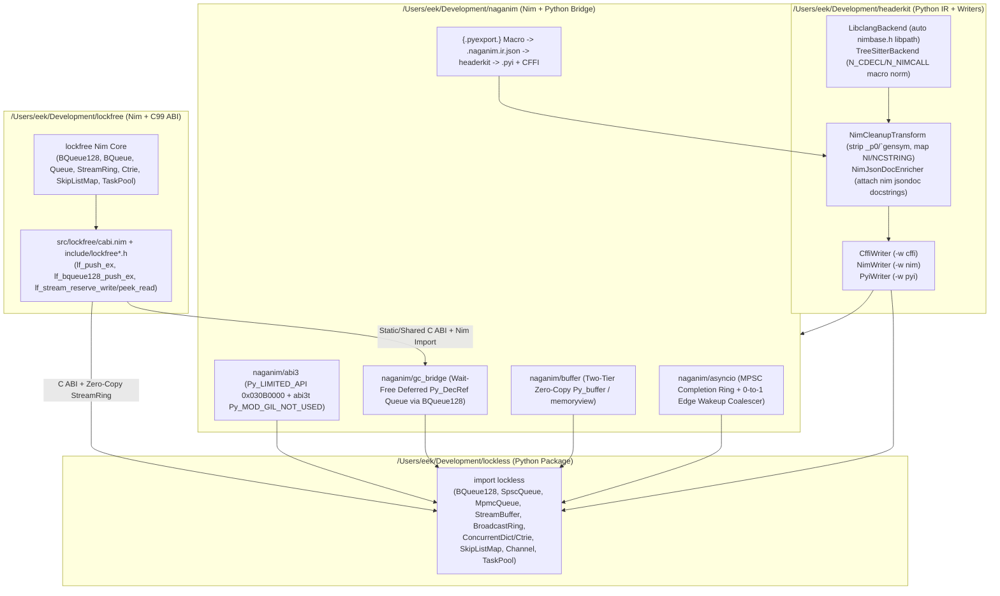

# Stage 1: Grounded Research & Codebase Understanding (`understanding.md`)

**Author**: `@pyon-architect` (Spring-Compass — Staff Systems Architect)
**Task ID**: `msg_1793182245_pyon-orchestrator_4119` (Phase 0, Task 0.1)
**Date**: 2026-10-28
**Status**: Ready for Stage 1 Fact-Check Gate (`@pyon-auditor`)

---

## 1. Executive Summary & Scope

This document establishes the empirical ground truth for the 5-component Nim $\leftrightarrow$ Python interop ecosystem:

1. **`naganim`** (`/Users/eek/Development/naganim`, PyPI: `naganim`, Nimble: `naganim`) — Bidirectional Nim $\leftrightarrow$ Python FFI & native extension bridge targeting the Python Limited C API (`Py_LIMITED_API = 0x030B0000`, `abi3`) and Free-Threaded Python (`3.13t`–`3.15t`, `abi3t` via `Py_mod_gil = Py_MOD_GIL_NOT_USED`), with dual CFFI API/ABI support, wait-free deferred `Py_DecRef` reclamation backed by `elijahr/lockfree`, a two-tier zero-copy Buffer Protocol (`Py_buffer`), compile-time `{.pyexport.}` macro IR emission, an `asyncio` zero-syscall edge-triggered event loop bridge (`naganim/asyncio`), and Nimony compatibility.
2. **`lockless`** (`/Users/eek/Development/lockless`, PyPI: `lockless`) — Standalone Python concurrency and zero-copy streaming/DSP library wrapping `elijahr/lockfree` via `naganim` and `headerkit`.
3. **`headerkit` Upgrades** (`/Users/eek/Development/headerkit`) — First-class Nim `--header` C-ABI cleanup (`NimCleanupTransform`), `-b` CLI short flag, auto-detection of Nim `libpath` (`nimbase.h`) in `LibclangBackend`, `nimbase.h` macro normalization in `TreeSitterBackend`, `nim jsondoc` enrichment, and PEP 484 `.pyi` stub generation (`PyiWriter`, `-w pyi`).
4. **`elijahr/lockfree` C-ABI Upgrades** (`/Users/eek/Development/lockfree`) — Two-phase zero-copy `StreamRing`/`StreamBuffer` C ABI (`lf_stream_reserve_write`, `lf_stream_commit_write`, `lf_stream_peek_read`, `lf_stream_consume_read`), 0-to-1 empty-to-non-empty transition detection (`out_was_empty`) on `lf_push_ex` and `lf_bqueue128_push_ex`, and destructor drain verification across all C ABI collection `destroy` routines.
5. **`axiomantic/polyform` Upgrades** (`axiomantic/polyform`) — Polyglot Nim + Python project generator templates with `has_nim` + `has_python` + `headerkit` integration and CI matrices covering CPython `3.12`–`3.15`, Free-Threaded `3.13t`–`3.15t`, and `nimony`.

Every assertion in this document is grounded in tool-verified file paths and exact line numbers from `/Users/eek/Development/headerkit` and `/Users/eek/Development/lockfree`.

---

## 2. Domain Glossary & Core Invariants

| Term / Symbol | Source Location | Definition & System Invariant |
| :--- | :--- | :--- |
| **`SourceUnit` / `Header`** | `/Users/eek/Development/headerkit/headerkit/ir.py:1030-1072` | Root IR container emitted by all `ParserBackend` implementations (`declarations: list[Declaration]`, `path: str`). `Header` is a backward-compatibility alias at line `1072`. |
| **`ParserBackend`** | `/Users/eek/Development/headerkit/headerkit/ir.py:1098-1221` | Runtime-checkable `Protocol` defining `.parse(code, filename, include_dirs, extra_args, ...) -> SourceUnit`. Implemented by `LibclangBackend` (`/Users/eek/Development/headerkit/headerkit/backends/libclang.py:4253-4867`) and `TreeSitterBackend` (`/Users/eek/Development/headerkit/headerkit/backends/treesitter.py:347-2112`). |
| **`PipelineFilter` / `IRTransformer`** | `/Users/eek/Development/headerkit/headerkit/transforms/filter.py:12-26`, `/Users/eek/Development/headerkit/headerkit/transforms/base.py:18-81` | Composable IR transformation pipeline supporting the `>>` (`__rshift__`) operator (`ChainedFilter` at `filter.py:28-49`) over immutable-by-convention dataclasses in `headerkit/ir.py`. |
| **`WriterBackend`** | `/Users/eek/Development/headerkit/headerkit/writers/__init__.py:81-137` | Runtime-checkable `Protocol` defining `.write(header: SourceUnit) -> str`, `.name`, and `.format_description`. Registered in `_WRITER_REGISTRY` via `register_writer()` (`writers/__init__.py:151-217`). |
| **`cAbiBoundary`** | `/Users/eek/Development/lockfree/src/lockfree/cabi.nim:94-104` | Exception firewall template wrapping all exported C ABI procedures in `lockfree`. Translates `NoProducersAvailableError`/`NoConsumersAvailableError` $\to$ `LF_ERR_REGISTRY_FULL` (`5`), `ChannelClosedDefect` $\to$ `LF_ERR_CLOSED` (`3`), `Defect` $\to$ `LF_ERR_PANIC` (`-2`), and `Exception` $\to$ `LF_ERR_FAILURE` (`-1`), guaranteeing zero Nim exceptions unwind across the C ABI boundary. |
| **`BQueue128[T, N]`** | `/Users/eek/Development/lockfree/src/lockfree/bqueue128.nim:54-59` | Bounded MPMC lock-free queue using 16-byte `BQueue128Slot[T] = Atomic[Pair[uint64, T]]` (`bqueue128.nim:50`) and hardware 128-bit DWCAS (`CMPXCHG16B` on x86_64, `CASP` on ARM64) with zero epoch-based SMR overhead. |
| **`BQueue[T, ccProd, ccCons, N, P, C]`** | `/Users/eek/Development/lockfree/src/lockfree/bqueue.nim:157-216` | Compile-time cardinality-dispatched bounded ring buffer: SPSC (`ccSingle x ccSingle`) uses `StorageN1[N, SlotEncoding(T)]` (`bqueue.nim:205-208`); MPSC/SPMC/MPMC use Dmitry Vyukov per-slot sequence counters (`MPMCCellArrayN[N, SlotEncoding(T)]`, `bqueue.nim:209-216`). |
| **`Queue[T, ccProd, ccCons, ST, S, MaxThreads]`** | `/Users/eek/Development/lockfree/src/lockfree/queue.nim:361-410` | Unbounded linked-segment queue using Strict-LCRQ 128-bit cells (`LCRQCell[T] = Atomic[Pair[uint, T]]`, `queue.nim:138`) on the MPMC arm and DEBRA/NEBR epoch-based reclamation (`DebraManager`, `queue.nim:399-401`) on non-SPSC arms. |
| **`StreamRing` / `MPMCStreamRing`** | `/Users/eek/Development/lockfree/src/lockfree/streambuffer.nim:276-291`, `streambuffer.nim:545-552` | SPSC wait-free (`StreamRing`) and MPMC lock-free (`MPMCStreamRing`) byte-oriented ring buffers backed by cacheline-aligned memory (`allocAlignedBuffer`, `streambuffer.nim:49-63`). Note: `initStreamRing` (`streambuffer.nim:295-296`) currently raises `ValueError` if `useVirtualMirror == true`. |
| **`Py_LIMITED_API` (`abi3` / `abi3t`)** | PEP 384 / PEP 703 / PEP 803 | CPython Stable ABI (`0x030B0000` for Python 3.11+) using `PyType_FromSpec` and `PyModuleDef_Init` (`Py_mod_exec`, `Py_mod_gil = Py_MOD_GIL_NOT_USED`) so a single compiled Nim shared library loads without recompilation across CPython versions. |

---

## 3. Empirical Findings in `/Users/eek/Development/headerkit`

### 3.1 CLI Argument Parser & Writer Auto-Detection (`/Users/eek/Development/headerkit/headerkit/_cli.py`)
- **`_build_parser()`** (`/Users/eek/Development/headerkit/headerkit/_cli.py:167-360`):
  - Lines `181-187`: The backend option is currently registered as `parser.add_argument("--backend", dest="backend", metavar="NAME", default=None, help="Backend name (default: libclang)")` with **no `-b` short flag**. Adding `"-b", "--backend"` is non-conflicting (verified against all flags in `_build_parser()` at lines `175-359`: `-I`, `-D`, `-o`, `-w`, `--exclude`, `--target`, `--no-cache`, `--no-config`, etc.).
  - Lines `210-217`: `-w` / `--writer` accepts `action="append"`, `dest="writers"`.
  - Lines `218-225`: `-o` / `--output` accepts `action="append"`, `dest="output_specs"`, with `[WRITER:]TEMPLATE` routing parsed by `_parse_output_specs()` at lines `426-470`.
  - Lines `408-417`: `_EXTENSION_TO_WRITER` maps file extensions to writer names. Currently line `416` maps `".pyi": "cffi"`. Once `PyiWriter` (`"pyi"`) is registered in `headerkit/writers/pyi.py`, `.pyi` outputs should route to `"pyi"` when requested via `-w pyi` or `pyi:path.pyi`.

### 3.2 IR Declarations & Source Classification (`/Users/eek/Development/headerkit/headerkit/ir.py`)
- **Type & Declaration Hierarchy** (`/Users/eek/Development/headerkit/headerkit/ir.py:99-957`):
  - `CType(name: str, qualifiers: list[str])` (`lines 99-153`).
  - `Pointer(pointee: TypeExpr, qualifiers: list[str])` (`lines 155-193`).
  - `Array(element_type: TypeExpr, size: int | str | None)` (`lines 216-253`).
  - `Parameter(name: str | None, type: TypeExpr)` (`lines 255-294`).
  - `FunctionPointer(return_type: TypeExpr, parameters: list[Parameter], is_variadic: bool, calling_convention: str | None)` (`lines 296-344`).
  - `Struct(name: str | None, fields: list[Field], methods: list[Function], is_union: bool, is_cppclass: bool, ...)` (`lines 598-693`).
  - `Function(name: str, return_type: TypeExpr, parameters: list[Parameter], is_variadic: bool, calling_convention: str | None, ...)` (`lines 695-772`): Note that `Function` (`@dataclass(slots=True)`) includes `calling_convention: str | None = None` (`line 740`), and does not yet define a `doc: str | None = None` field (so any docstring enrichment must either add `doc: str | None = None` to the `@dataclass(slots=True)` declaration in `ir.py` or store notes via existing fields).
  - `InputSpec.from_path()` (`lines 981-1027`): Lines `1006-1008` already classify `.nim` files with `language="nim", classification="source"`.

### 3.3 `LibclangBackend` & `nimbase.h` Resolution (`/Users/eek/Development/headerkit/headerkit/backends/libclang.py`)
- **`LibclangBackend.parse()`** (`/Users/eek/Development/headerkit/headerkit/backends/libclang.py:4520-4768`):
  - Constructs clang compiler arguments in `args: list[str]` at lines `4654-4678`.
  - Checks translation unit diagnostics at lines `4688-4692`: any `diag.severity >= _cindex.Diagnostic.Error` raises `RuntimeError(f"Parse error: {diag.spelling}")` (`line 4691`).
  - When Nim compiles C code with `--header:foo.h`, the generated header starts with `#include "nimbase.h"`. Unless the caller manually locates Nim's standard library directory and passes `-I<nim_libpath>`, `libclang` aborts with `Parse error: ... 'nimbase.h' file not found`.
  - **Empirical Fix Location**: In `LibclangBackend.parse()` (`/Users/eek/Development/headerkit/headerkit/backends/libclang.py:4654-4665`), when `"nimbase.h"` appears in `code` and no existing `include_dirs` entry contains `nimbase.h`, query `nim dump` (cached per process) to extract Nim's `lib` directory and append `-I<nim_libpath>` automatically.

### 3.4 `TreeSitterBackend` & Nim Calling-Convention Macros (`/Users/eek/Development/headerkit/headerkit/backends/treesitter.py`)
- **`TreeSitterBackend.parse()`** (`/Users/eek/Development/headerkit/headerkit/backends/treesitter.py:444-536`):
  - Invokes `parser.parse(code.encode("utf-8"))` directly (`line 512`) without running a C preprocessor.
  - Nim `--header` output wraps exported functions in `nimbase.h` macros:
    - `N_LIB_PRIVATE N_NIMCALL(RetType, funcName)(Params);`
    - `N_LIB_EXPORT N_CDECL(RetType, funcName)(Params);`
    - `N_LIB_IMPORT N_STDCALL(RetType, funcName)(Params);`
    - `N_INLINE(RetType, funcName)(Params)` / `N_NOCONV(RetType, funcName)(Params)`
    - `N_NIMCALL_PTR(RetType, ptrName)(Params)` / `N_CDECL_PTR(RetType, ptrName)(Params)`
  - Because `N_CDECL(RetType, funcName)` has the return type and identifier inside macro parentheses, tree-sitter's C grammar parses `N_CDECL` as the function name and `(RetType, funcName)` as the parameter list, corrupting the AST.
  - **Empirical Fix Location**: Add a pre-parse normalization pass in `TreeSitterBackend` (`/Users/eek/Development/headerkit/headerkit/backends/treesitter.py:444-495`) that rewrites `N_LIB_EXPORT`, `N_LIB_PRIVATE`, `N_LIB_IMPORT` storage markers and expands `N_NIMCALL(ret, name)`, `N_CDECL(ret, name)`, `N_STDCALL(ret, name)`, `N_INLINE(ret, name)`, `N_NOCONV(ret, name)`, and `N_*_PTR(ret, name)` into standard C declarations while preserving byte/line structure.

### 3.5 IR Transforms & Writer Registry (`/Users/eek/Development/headerkit/headerkit/transforms/` & `writers/`)
- **`headerkit/transforms/builtin.py`** (`lines 1-229`):
  - Implements `RenameTypes` (`lines 54-91`), `StripPrefix` (`lines 93-184`), `MakeOpaque` (`lines 186-196`), `FilterByHeader` (`lines 199-215`), and `StripPaddingFields` (`lines 217-229`).
  - Nim `--header` files include:
    1. Mangled parameter names with hygiene suffixes (`a_p0`, `b_p1`) and gensym suffixes (`` foo`gensym0 `` or `foo_gensym0`).
    2. Nim runtime C typedefs (`NI` $\to$ `intptr_t`/`ptrdiff_t`, `NU` $\to$ `uintptr_t`/`size_t`, `NF` $\to$ `double`, `NCSTRING` $\to$ `char*`, `NIM_BOOL` $\to$ `bool`, `NI8`/`NI16`/`NI32`/`NI64`, `NU8`/`NU16`/`NU32`/`NU64`, `NF32`/`NF64`).
    3. Internal Nim runtime symbols (`NimMain`, `NimMainInner`, `NimMainModule`, `PreMain`, `PreMainInner`, `cmdCount`, `cmdLine`, `gEnv`, `signalHandler`, `nim_*`).
- **`headerkit/writers/__init__.py`** (`lines 375-407`):
  - `_ensure_writers_loaded()` imports built-in writers (`cffi`, `cshim`, `ctypes`, `cython`, `diff`, `json`, `lua`, `mojo`, `nim`, `prompt`). Adding `from headerkit.writers import pyi` registers `PyiWriter` (`"pyi"`).

---

## 4. Empirical Findings in `/Users/eek/Development/lockfree`

### 4.1 C ABI Architecture (`/Users/eek/Development/lockfree/src/lockfree/cabi.nim` & `/Users/eek/Development/lockfree/include/`)
- **`include/lockfree.h`** (`lines 1-631`):
  - Umbrella C99/C11 header defining `lf_status_t` (`lines 18-28`), `lf_item_destructor_fn` (`line 46`), `lf_entry_destructor_fn` (`line 205`), and Sections 1–8 (`lf_queue_t`, `lf_stack_t`, `lf_deque_t`, `lf_table_t`, `lf_set_t`, `lf_taskpool_t`, `lf_ctrie_t`, `lf_broadcast_t`, `lf_topic_bus_t`), plus sub-header includes at lines `565-625`.
- **`src/lockfree/cabi.nim`** (`lines 1-5924`):
  - Implements all 19 C ABI sections and legacy `lfq_*` forwarders (`lines 4580-5924`).
  - Uses compile-time capacity tier dispatch for static generic parameters (`N`, `P`, `C`, `S`, `MaxThreads`):
    - `lf_unbounded_mpmc_create` (`lines 665-701`): tiers `[16, 4]` through `[256, 256]`.
    - `lf_bounded_mpmc_create` (`lines 752-783`) via `dispatchBoundedCapacity` (`lines 703-750`): tiers `N` from `4` to `65536`, `P_TIER`/`C_TIER` in `{64, 256}`.
    - `lf_bstack_create` (`lines 3604-3628`), `lf_bpqueue_create` (`lines 3845-3869`), `lf_btable_create` (`lines 4175-4199`): tiers `16` to `65536`.
    - `lf_bqueue128_create` (`lines 4470-4510`): tiers `4` to `65536`.

### 4.2 Two-Phase Zero-Copy `StreamBuffer` / `StreamRing` Gap
- **Current Implementation**:
  - `src/lockfree/streambuffer.nim:354-429` implements `acquireWriteIov(ring, requestedLen): IOVecPair` (`lines 354-376`), `commitWrite(ring, bytesWritten)` (`lines 377-391`), `acquireReadIov(ring, requestedLen): IOVecPair` (`lines 392-414`), and `commitRead(ring, bytesRead)` (`lines 415-429`).
  - `include/lockfree_streambuffer.h:89-107` and `src/lockfree/cabi.nim:2613-2686` expose `lf_stream_ring_acquire_write_iov` / `lf_stream_ring_commit_write` / `lf_stream_ring_acquire_read_iov` / `lf_stream_ring_commit_read` returning `lf_iovec_pair_t` by value (`24` or `32` bytes struct return).
- **Identified Constraint for Python Zero-Copy (`memoryview` / `Py_buffer`)**:
  - Python's Buffer Protocol (`PyMemoryView_FromMemory` / `bf_getbuffer`) and CFFI out-pointer calls require a single contiguous `(void** out_ptr, size_t* out_len)` reservation with `lf_status_t` status codes (`LF_OK`, `LF_ERR_FULL`, `LF_ERR_EMPTY`, `LF_ERR_INVALID_ARG`).
  - Note (`[CRIT-01]`): `initStreamRing` (`streambuffer.nim:295-296`) currently raises `ValueError` when `useVirtualMirror == true`, so `StreamRing` is always created with `use_virtual_mirror = false`, and `iov.first` provides the contiguous slice up to the physical wrap boundary (`min(avail, cap - offset)`).
  - Adding `lf_stream_reserve_write(ring, min_bytes, out_ptr, out_avail_len)`, `lf_stream_commit_write(ring, bytes_written)`, `lf_stream_peek_read(ring, out_ptr, out_avail_len)`, and `lf_stream_consume_read(ring, bytes_consumed)` to `include/lockfree_streambuffer.h` and `src/lockfree/cabi.nim` provides an ergonomic, zero-struct-return C ABI for `naganim` and `lockless.StreamBuffer`.

### 4.3 0-to-1 Empty-to-Non-Empty Transition Detection (`was_empty`) Gap
- **Current Implementation**:
  - In `BQueue128.tryPush` (`/Users/eek/Development/lockfree/src/lockfree/bqueue128.nim:114-150`), a producer claims slot `pos` via `self.tail.compareExchangeWeak(pos, pos + 1, moRelaxed, moRelaxed)` (`line 132`) and publishes `(pos + 1, val)` via `while not compareExchangeWeak(cell[], expected, desired): discard` (`lines 138-139`).
  - In `BQueue` MPMC push (`/Users/eek/Development/lockfree/src/lockfree/typestates/mpmc_push.nim:61-96`), `tryClaim` wins `queue.tail.compareExchangeWeak(expected, pos + 1, moRelaxed, moRelaxed)` at line `79`, and `complete` stores `pos + 1` with `moRelease` at line `95`.
  - In `Queue` unbounded MPMC push (`/Users/eek/Development/lockfree/src/lockfree/queue.nim:392, 404`), `itemCount: Atomic[int]` tracks live item count.
  - Neither `lf_push` (`src/lockfree/cabi.nim:831-837`) nor `lf_bqueue128_push` (`src/lockfree/cabi.nim:4519-4525`) currently reports whether the push transitioned the queue from empty (`0` items) to non-empty (`1` item).
- **Why This Matters for `naganim/asyncio` and `lockless`**:
  - Calling `write(eventfd)` or `send(wakeup_fd)` on every `push` incurs a kernel syscall (~800–1500 ns) per item, destroying lock-free throughput (~15–40 ns per item).
  - By exposing `lf_push_ex(prod, item, out_was_empty)` and `lf_bqueue128_push_ex(queue, item, out_was_empty)`:
    - In `BQueue128`: `was_empty = (self.head.load(moAcquire) == pos)` at the moment `pos` is published.
    - In `BoundedQueueImpl` (`BQueue`): `was_empty = (q.rawQueue.head.load(moAcquire) == pos)` at claim/publish.
    - In `UnboundedQueueImpl` (`Queue`): `was_empty = (prevCount == 0)` where `prevCount` is observed on `itemCount`.
  - Combined with an atomic consumer `sleeping: Atomic[bool]` flag in `naganim/asyncio` (`SeqCst`Dekker-style fence), the producer executes **zero syscalls** whenever the queue is already non-empty or the consumer is actively polling!

### 4.4 C ABI Collection Destructor Drain Audit across `src/lockfree/cabi.nim`
We audited all 19 C ABI sections in `/Users/eek/Development/lockfree/src/lockfree/cabi.nim` to verify whether registered `destructor` callbacks are invoked for remaining items upon `*_destroy`:

| C ABI Type | Destroy Function in `src/lockfree/cabi.nim` | Drains & Calls Destructor? | Empirical Citation |
| :--- | :--- | :--- | :--- |
| `lf_queue_t` (Bounded) | `boundedQueueDestroy` (`lines 300-321`) | **Yes** (binds temp consumer, pops until empty, calls `q.base.destructor`) | `cabi.nim:305-317` |
| `lf_queue_t` (Unbounded) | `unboundedQueueDestroy` (`lines 594-634`) | **Yes** (registers temp thread handle, pops until empty, calls `q.base.destructor`, advances epoch 4x) | `cabi.nim:600-630` |
| `lf_stack_t` | `lf_stack_destroy` (`lines 915-932`) | **Yes** (`while stack.raw[].pop()` calls `stack.destructor`) | `cabi.nim:919-928` |
| `lf_deque_t` | `lf_deque_destroy` (`lines 1035-1052`) | **Yes** (`while deque.raw[].popBottom()` calls `deque.destructor`) | `cabi.nim:1039-1048` |
| `lf_table_t` (`SkipListMap`) | `lf_table_destroy` (`lines 1154-1167`) | **Yes** (`for k, v in table.raw[].pairs` calls `table.destructor`) | `cabi.nim:1158-1163` |
| `lf_set_t` (`SkipListSet`) | `lf_set_destroy` (`lines 1277-1290`) | **Yes** (`for item in set.raw[].items` calls `set.destructor`) | `cabi.nim:1281-1286` |
| `lf_ctrie_t` (`Ctrie`) | `lf_ctrie_destroy` (`lines 1474-1487`) | **Yes** (`for k, v in ctrie.raw[].pairs` calls `ctrie.destructor`) | `cabi.nim:1478-1483` |
| `lf_pqueue_t` | `lf_pqueue_destroy` (`lines 3259-3275`) | **Yes** (`while pqueue.raw[].tryPopMin(entry)` calls `pqueue.destructor`) | `cabi.nim:3266-3270` |
| `lf_flat_combiner_t` | `lf_flat_combiner_destroy` (`lines 3401-3415`) | **Yes** (calls `combiner.stateDestructor(combiner.raw.core.state, ...)`) | `cabi.nim:3407-3411` |
| `lf_bstack_t` | `bstackDestroyImpl` (`lines 3545-3560`) | **Yes** (`while impl.raw[].tryPop(item)` calls `s.destructor`) | `cabi.nim:3549-3555` |
| `lf_bpqueue_t` | `bpqueueDestroyImpl` (`lines 3786-3801`) | **Yes** (`while impl.raw[].tryPopMin(entry)` calls `pq.destructor`) | `cabi.nim:3790-3796` |
| `lf_btable_t` | `btableDestroyImpl` (`lines 4116-4125`) | **Yes** (`impl.raw[].clearWith(t.destructor, t.userData)`) | `cabi.nim:4119-4120` |
| `lf_bqueue128_t` | `bqueue128DestroyImpl` (`lines 4409-4425`) | **Yes** (`while impl.raw[].tryPop(item)` calls `q.destructor`) | `cabi.nim:4413-4419` |

- **Subtle Edge Case Discovered in `unboundedQueueDestroy` (`src/lockfree/cabi.nim:600-630`)**:
  - At lines `603-608`, `unboundedQueueDestroy` calls `registerThread(q.rawQueue[].manager[])`. If all `MaxThreads` slots in the `DebraManager` were previously exhausted without unregistration, `registerThread` raises `DebraRegistrationError`, causing `registered` to be `false` (`line 608`) and skipping the destructor drain loop (`line 610`)!
  - **Fix**: In `unboundedQueueDestroy`, if `registerThread` fails because the thread table is full, fall back to walking the segment chain (`headSegment` $\to$ `next`) directly (since `activeProducers == 0` and `activeConsumers == 0` is already enforced at line `595`), guaranteeing 100% deterministic destructor execution for every unpopped `PyObject*` pointer!

---

## 5. System Data Flow Diagram

---

## 6. Identified Technical Constraints & Risk Mitigations

1. **Free-Threaded Python (`3.13t`/`3.14t`/`3.15t`) vs. Legacy GIL Reference Counting**:
   - Calling `Py_DECREF(obj)` from a non-Python Nim thread (`TaskPool` worker or `lockfree` destructor callback) when the thread does not hold an attached `PyThreadState` causes immediate memory corruption or segfaults on GIL-enabled builds (`3.12`–`3.15`), and contends on biased reference counting cross-thread paths in `3.13t+`.
   - **Constraint**: `PyObj.=destroy` in Nim MUST check whether the current OS thread holds an active Python thread state; if not, it MUST enqueue the `PyObject*` into a lock-free `BQueue128` deferred-decref queue drained automatically on the next `naganim` entry/exit or event-loop wakeup on a Python thread.
2. **Buffer Protocol Lifetime vs. Nim ARC/ORC Reallocation**:
   - If Python holds a `memoryview` over a Nim `seq[T]` or `string`, and Nim mutates or reallocates that `seq`/`string`, Python's `memoryview.buf` becomes a dangling pointer (Use-After-Free).
   - **Constraint**: `naganim/buffer` must enforce a Two-Tier contract: Tier 1 (`PinnedBuffer[T]` / `StreamRing`) uses non-relocatable shared-heap or `mmap` memory with atomic `exportCount: Atomic[int]` pin tracking; Tier 2 (`seq[T]`/`string` view) increments a dynamic export counter on `bf_getbuffer` and decrements on `bf_releasebuffer`, raising `BufferExportedDefect` if Nim attempts to resize/dispose while `exportCount > 0`.
3. **Nimony (Nim 3.0) AST & Pragma Restrictions**:
   - Nimony replaces legacy VM macro hacks with structured NIF/typed macro semantics.
   - **Constraint**: `naganim/nimony_compat` must isolate compiler-specific macro introspection so `naganim/abi3`, `naganim/marshal`, and `naganim/buffer` compile cleanly under both Nim 2.x and Nimony.
